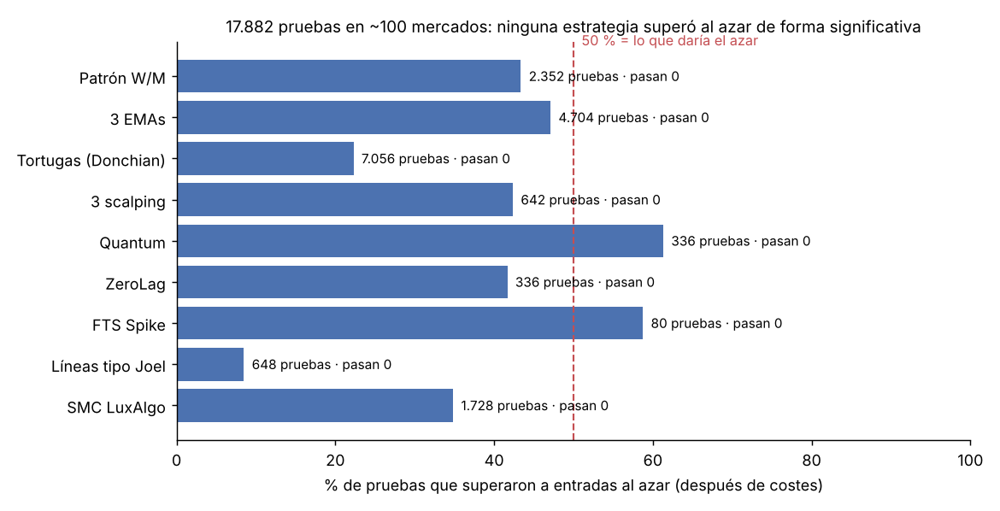
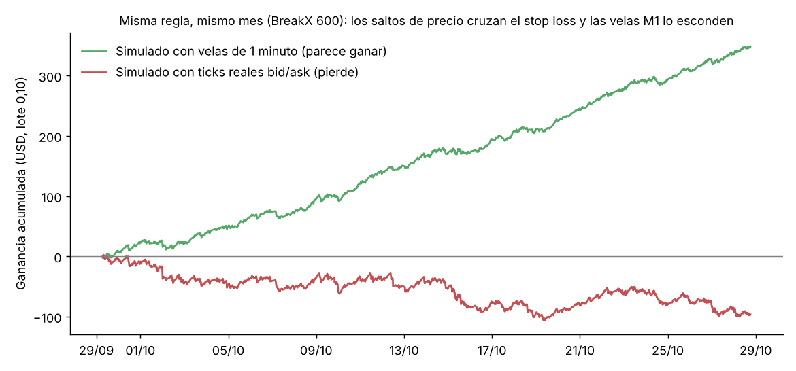
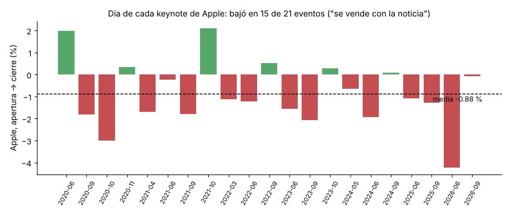

# Trading Research MT5 — investigación cuantitativa de estrategias de trading

**Autor:** Raúl · Ingeniero en Sistemas · Guayaquil, Ecuador

Sistema en **Python + MQL5** para comprobar, con datos reales y estadística, si estrategias de trading populares
(de YouTube, cursos y de indicadores comerciales) tienen una ventaja real **después de costes**.
Conecta con MetaTrader 5, descarga y limpia el historial de ~100 mercados, simula cada estrategia minuto a minuto
(o tick a tick), la compara contra entradas al azar y corrige por pruebas múltiples.

> **Resultado principal:** en **17.882 pruebas** (9 familias de estrategias, ~100 mercados, M1 a D1) **ninguna**
> estrategia superó al azar de forma estadísticamente significativa una vez descontados spread y swap.
> El proyecto documenta también cómo un resultado que parecía excelente resultó ser un **sesgo de los datos**
> (velas de 1 minuto vs ticks reales) y cómo se detectó.



*English summary:* end-to-end quantitative research pipeline (MT5 API extraction → data quality checks →
numba-accelerated event-driven backtests → random-entry baselines → Holm correction → hold-out evaluation →
tick-level verification). 17,882 strategy tests; none showed a statistically significant edge after costs.

---

## Qué hace (pipeline de datos)

| Etapa | Qué se hizo | Archivos |
|---|---|---|
| **Extracción** | API de MetaTrader 5 (solo lectura): ~100 mercados (criptos, metales, índices, acciones, forex, sintéticos), velas M1 desde 2017 y ticks bid/ask | `src/descargar_m1.py`, `src/descargar_sinteticos.py`, `src/descargar_ticks.py`, `src/listar_simbolos.py` |
| **Calidad de datos** | Detección automática del historial completo (≥80 % de minutos por día), reintentos por rangos, ajuste de *splits* de acciones, verificación de que las temporalidades reconstruidas desde M1 son idénticas a las de MT5, zona horaria del servidor | `src/motor.py`, `src/verificar_mt5.py` |
| **Costes reales** | Spread por vela con piso prudente, swap con día triple, comisión leída de la cuenta, valor monetario por lote con `order_calc_profit` | `src/wm.py`, `src/leer_comision.py` |
| **Motores de señales** | W/M, 3 EMAs, Tortugas, 3 estrategias de scalping, indicadores Quantum/ZeroLag (decodificados), FTS Spike (exportado desde MT5), líneas de tendencia tipo "toque 3", Smart Money Concepts (BOS/CHoCH, Order Blocks, FVG — lógica LuxAlgo) | `src/*.py`, `src/lineas_nb.py`, `src/smc_nb.py` |
| **Simulación** | Ejecución en M1 (o ticks) sin mirar el futuro, stops con salto realista, una operación a la vez; acelerado con **numba** (millones de velas en segundos) | `src/correr_*.py`, `src/sim_ticks.py` |
| **Estadística** | Control con 3.000 entradas al azar con la misma salida y costes, test de Welch, **corrección de Holm** sobre todas las pruebas, mayoría de años positivos, sensibilidad al spread ×1,5 | `src/global_holm.py`, `src/global_smc.py` |
| **Reserva (out-of-sample)** | El último 25 % de cada mercado nunca se usa al diseñar; se evalúa **una sola vez** con la regla de decisión escrita antes | `docs/planes/` |
| **Verificación con ticks** | Re-simulación tick a tick con bid/ask reales para descartar sesgos de las velas | `src/sim_ticks.py`, `src/estres_salto.py` |
| **Herramientas MT5** | Indicadores con escáner multi-mercado/multi-temporalidad, alertas al celular y asesores expertos con bloqueo de cuenta real por defecto | `mql5/` |

## El hallazgo más importante: las velas pueden mentir

Una regla de Smart Money Concepts en los índices sintéticos BreakX/TrendX/SwitchX parecía ganar **todos los meses**
(29.000 operaciones, desarrollo y reserva). Antes de usarla se re-simuló con **ticks reales**: estos índices
tienen *saltos* que cruzan el stop loss de golpe (~1.000-1.600 puntos más de pérdida por operación), algo que
una vela de 1 minuto no muestra. Con ticks, la misma regla **pierde** en los 6 mercados verificados.



**Lección:** validar el supuesto de ejecución (¿cómo se llena el stop?) es tan importante como la estrategia.

## Otro ejemplo: trading con noticias (event study)

¿Conviene comprar Apple por sus eventos de producto? Con 21 keynotes (2020-2026): el día del evento la acción
bajó en 15 de 21 (media −0,88 %, p≈0,01 sin corregir; ≈0,09 corregido): "se compra con el rumor, se vende con
la noticia". Los resultados trimestrales no mostraron diferencia frente a un día normal.



## Resultados por familia

| Familia | Pruebas | % mejor que el azar | Pasan la regla |
|---|---|---|---|
| Patrón W/M (doble/triple piso y techo) | 2.352 | 43 % | 0 |
| 3 EMAs 30/50/100 | 4.704 | 47 % | 0 |
| Tortugas (Donchian 20/55) | 7.056 | 22 % | 0 |
| 3 estrategias de scalping | 642 | 42 % | 0 |
| Indicador Quantum | 336 | 61 % | 0 |
| Indicador ZeroLag | 336 | 42 % | 0 |
| FTS Spike | 80 | 59 % | 0 |
| Líneas de tendencia "toque 3" | 648 | 8 % | 0 |
| Smart Money Concepts (LuxAlgo) | 1.728 | 35 % | 0 |

Regla de decisión (fijada antes de cada prueba): ≥30 operaciones, ganancia neta > 0, p corregida por Holm < 0,05,
mayoría de años positivos y positiva con el spread ×1,5. Tablas completas en `resultados/`.

## Estructura

```
src/         Python: extracción, limpieza, motores de señales, backtests, estadística
mql5/        Indicadores y asesores para MetaTrader 5 (Patron 123 con escáner, Patrón W/M)
config/      Especificaciones de los símbolos (punto, contrato, swap) leídas de MT5
docs/        Metodología, lecciones y los planes escritos ANTES de cada prueba
resultados/  Tablas finales por familia de estrategia (una fila = una prueba)
img/         Gráficos de este README
```

## Cómo ejecutarlo

```bash
pip install -r requirements.txt
# 1) con MetaTrader 5 abierto (Windows): descargar datos — solo lectura, no envía órdenes
python src/descargar_m1.py
# 2) backtest de una familia en un mercado (desde la raíz del repo)
python src/correr_smc.py BTCUSD 2018-09-01 "2026-10-25 02:53"
# 3) tabla global con corrección de Holm
python src/global_smc.py resultados 0
```
Los datos de mercado no se incluyen (son del bróker); se descargan con los scripts de `src/`.

## Tecnologías
Python (pandas, NumPy, numba, SciPy, matplotlib), API MetaTrader5, MQL5, faster-whisper (transcripción de videos
de estrategias para extraer sus reglas), Git.

## Aviso
Proyecto de investigación y aprendizaje. No es asesoría financiera. Los asesores MQL5 vienen con
"Permitir operar en cuenta REAL = false" por defecto.
